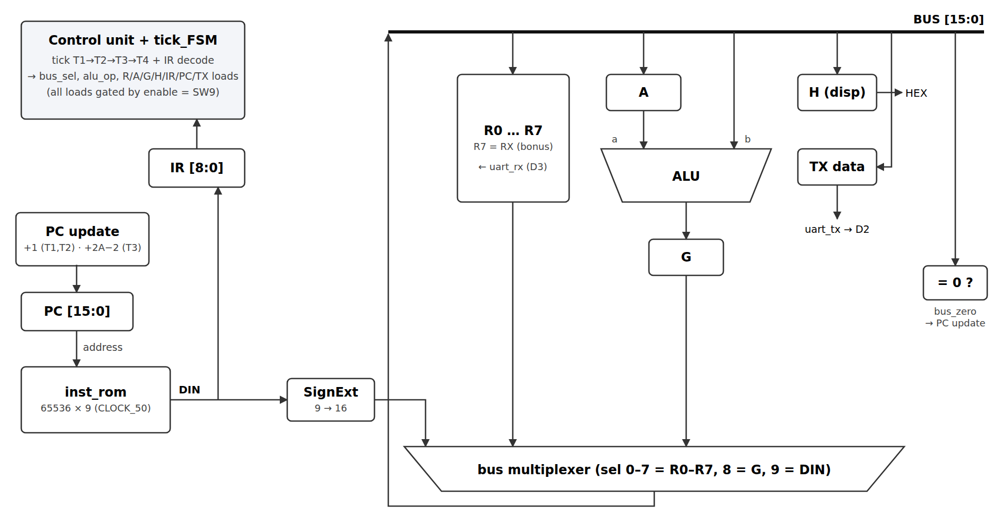
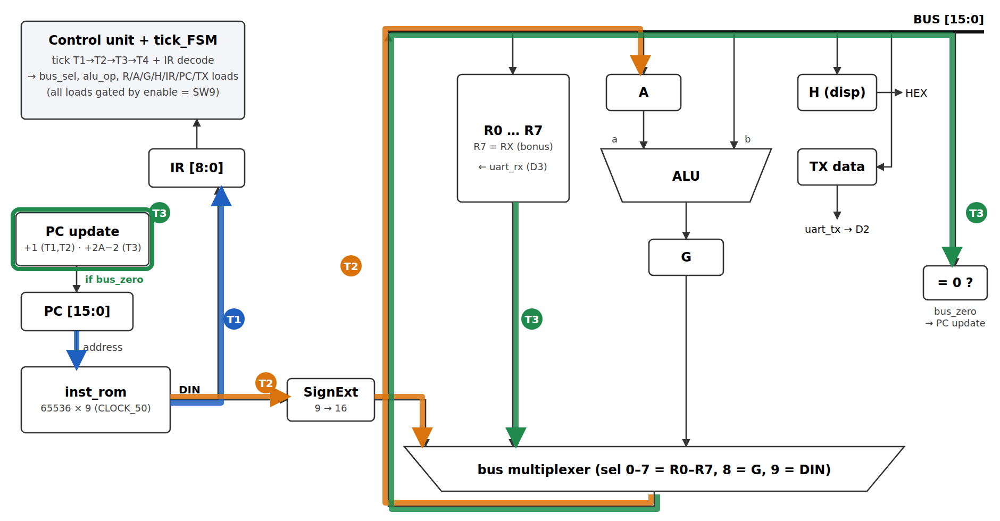
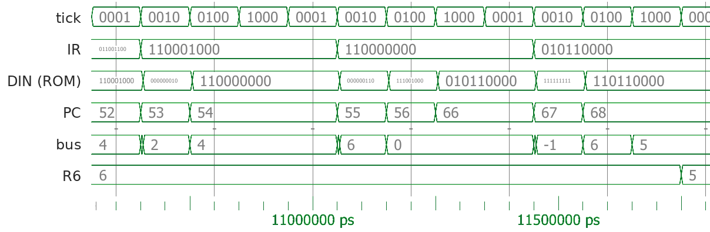
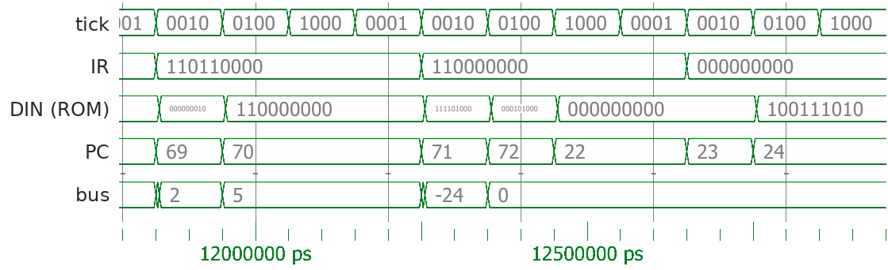
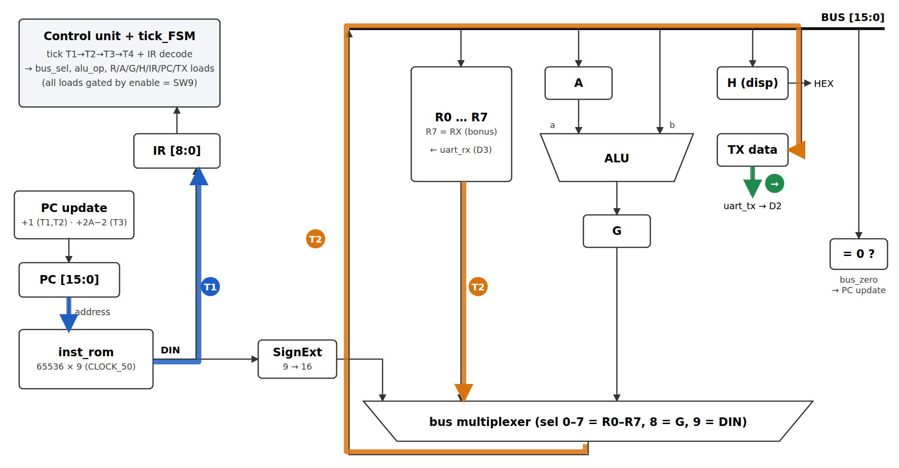
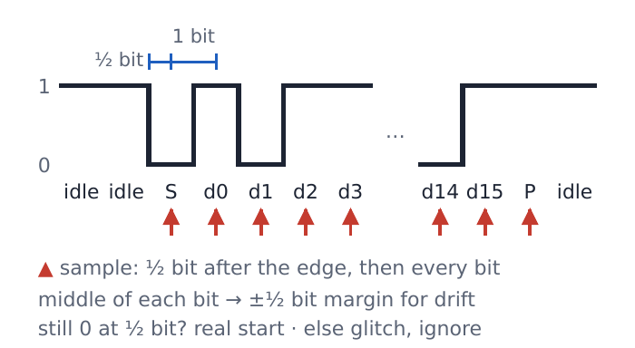
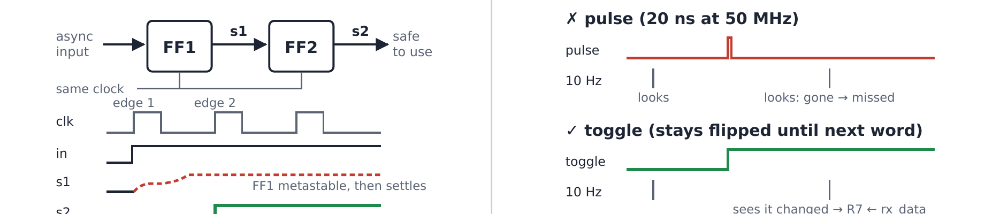
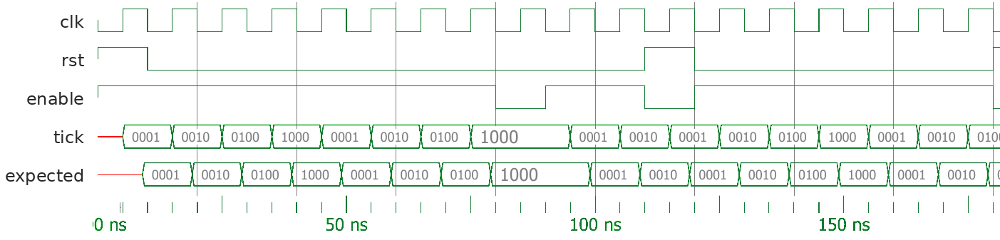
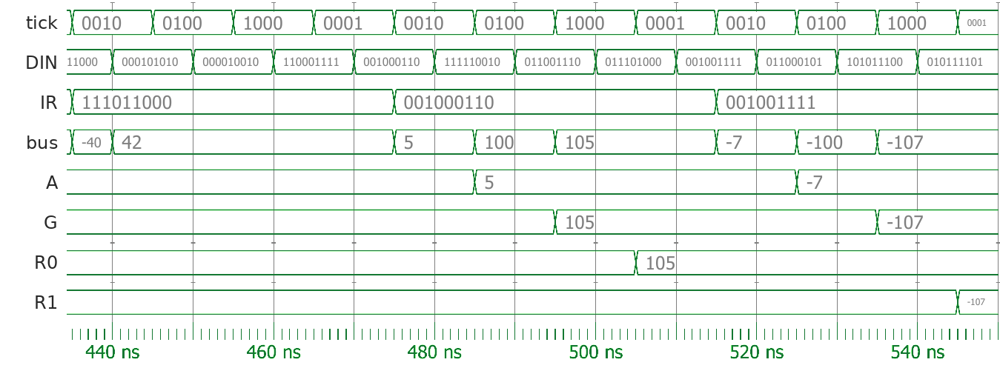
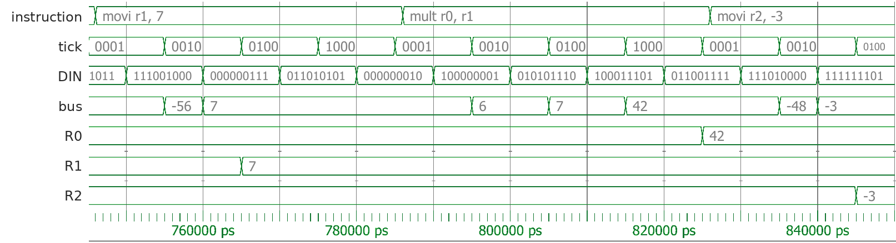

# x72: a 16-bit processor on an FPGA

A small 16-bit processor I designed in Verilog and ran on a Terasic DE10-Lite (Intel MAX 10). It started as a set of datapath components and grew into a CPU that fetches its own program from on-chip ROM, branches, and talks to a second board over a UART link I added myself.

> **Why there is no source code here:** this was university coursework, and the same project may be set again. To keep it fair for future students, this repo only shows the design, the results and the verification approach. The Verilog, testbenches and assembler stay private. If you're a recruiter or engineer and want to see the code, get in touch and I can walk you through it.

## At a glance

| | |
|---|---|
| Word size | 16-bit data, 9-bit instruction words |
| Registers | 8 general-purpose (R0–R7), plus A, G, IR, PC and a display register |
| Architecture | Single shared bus driven by a 10-input multiplexer; every instruction takes 4 ticks |
| Instructions | `movi` `add` `addi` `sub` `mult` `ssi` (signed shift) `disp` `bez` (branch if zero), plus my own `tx` |
| Memory | 65,536 × 9 instruction ROM, program counter with its own branch adder |
| Extras | UART link between two boards, clock domain crossing from 50 MHz to 10 Hz |
| Tools | Quartus Prime Lite 18.1, ModelSim, Python |
| Verification | ~4,950 component checks and 25,000+ processor checks, all passing |

## How it was built

The design grew in four stages, each with its own self-checking testbench:

1. **Components:** sign extender, bus multiplexer, ALU (multiply, add, subtract, signed shift), parameterised register and a one-hot tick FSM.
2. **Basic processor:** a control unit that decodes the instruction and the current tick, running `movi`, `add`, `addi` and `sub` entered on the board's switches.
3. **Extended processor:** `mult`, `ssi` and `disp`, with signed decimal output on the 7-segment displays.
4. **Stored-program processor:** a program counter, an instruction ROM and the conditional branch `bez`, running a program from memory at 10 Hz.

## Walkthrough: a branch, tick by tick

`bez Rx, Imm` jumps `Imm` instructions if `Rx` is zero. The zero test sits on the bus and the PC has its own adder, so the test and the jump happen in the same tick and no instruction needed extra cycles.

| Tick | What happens |
|---|---|
| T1 | PC addresses the ROM, IR loads the instruction, PC + 1 |
| T2 | Immediate is sign-extended and passes over the bus into A, PC + 1 |
| T3 | Rx goes onto the bus; if it is zero, PC ← PC + 2A − 2 |
| T4 | Idle |

Testbench waveforms showing a branch not taken, a forward jump and a backward jump (PC 72 → 22):

## The demo program: an electronic dice

The processor runs a dice game from ROM: six rolls per round, each shown on the display, all ten LEDs flash three times on a six, and the round total appears at the end.

- **Random numbers** come from a linear congruential generator, x ← 25173x + 13849 (mod 65536). The modulus is free because 16-bit arithmetic overflows naturally, and the constants give the full 65,536-value period.
- **Top bits only:** the low bits of an LCG repeat quickly, so each roll uses the top three bits.
- **Fair die:** values 6 and 7 are rejected and redrawn (rejection sampling). Taking the value mod 6 would make two faces twice as likely.

## Bonus: two boards talking over UART

I extended the instruction set with a `tx` instruction that reuses spare bits in an existing encoding, so no opcode was lost and old programs still run. R7 became a read-only receive register. Both boards run the same program, each sending its own count and displaying the other board's.

The UART (9600 baud, 16 data bits) is my own. The processor runs at 10 Hz and the UART at 50 MHz, so every signal between them goes through a two-flip-flop synchroniser. A one-cycle "new word" pulse at 50 MHz would be missed by a 10 Hz clock, so the receiver toggles a flag instead, which stays changed until the slow side sees it.

## Verification

Every stage has a self-checking ModelSim testbench. Each check prints a FAIL line with the expected and actual values, each test group reports PASSED or FAILED, and `success` prints only if everything passes.

| Testbench | Checks | Highlights |
|---|---|---|
| Components | 4,952 | All 512 sign-extend inputs; 4,000 random ALU vectors against a separate reference model; registers checked for changes between clock edges |
| Basic processor | ~7,100 | All eight registers checked after every instruction, so a write to the wrong register fails too; 400 random instructions |
| Extended processor | ~11,400 | 600 random instructions of all seven types; display hold and reset checks |
| Stored program | ~6,700 | Runs the real ROM and compares every instruction against a trace from my Python assembler / reference model |

**Testing the testbench:** I injected three deliberate bugs (zero-fill sign extension, asynchronous reset, an FSM that ignores enable). Each one was caught by the right test group while everything else still passed.

## Resource usage and timing

Each component was compiled inside a register wrapper so the Timing Analyzer measures only its own path (Slow 1200 mV 85 °C model).

| Component | Logic cells | Fmax (MHz) | What limits it |
|---|---|---|---|
| Sign extender | 0 | 1090 (capped at 250) | Wiring only |
| Tick FSM | 5 | 545 (capped at 250) | One logic level |
| Register (16-bit) | 17 | 200 | Reset fanout to all 16 flip-flops (80% routing) |
| ALU | 202 + 1 DSP block | 118 | Negative-shift path through the negation carry chain |
| Bus multiplexer | 96 | 88 | Select-line fanout (82% routing) |

The extended processor's Fmax of 54.7 MHz is roughly the multiplexer plus the ALU, which is the register → bus → ALU → G path. All five builds compile with no errors and meet timing in every corner.

## What I'd do next

- Let short instructions finish in two ticks instead of four
- Add a "load upper immediate" instruction for 16-bit constants
- Add a small receive FIFO to the UART
- Seed the dice from a free-running counter on a key press
